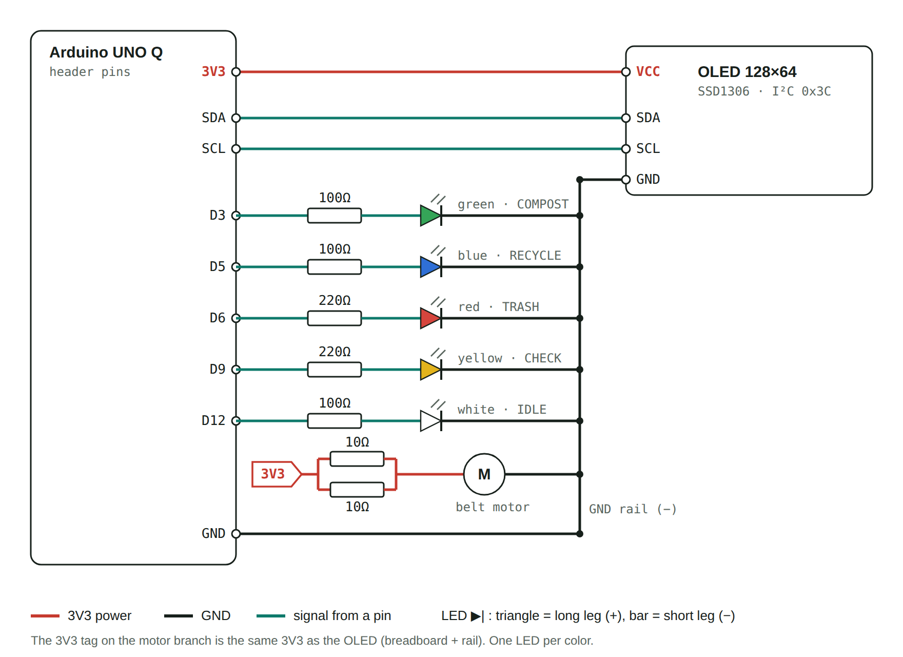
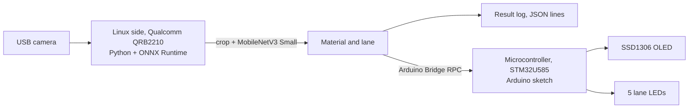

# Edge AI Waste Sorter on Arduino UNO Q

An offline machine-vision waste sorter built in two days at the **Embedded World North America Edge AI Hackathon** (Anaheim, September 2026). A USB camera watches items on a small conveyor belt, a MobileNetV3 classifier running on the Arduino UNO Q decides whether each item belongs in **compost, recycling, or trash**, and the result appears on an OLED display and a set of lane LEDs. No laptop, cloud, or network is needed while it runs.

**Result:** Runner-up (2nd of 3 teams) in the ASUS-sponsored Sustainability Challenge, one of four challenge tracks (12 teams overall).



## How it works

The Arduino UNO Q has two processors, and the project uses both:



1. The Python app grabs a camera frame about once per second and crops the belt area.
2. An empty-belt check compares the crop with a picture of the bare belt learned at startup, so only real items are sent on.
3. A seven-class MobileNetV3 Small model (ONNX Runtime, CPU) predicts the material.
4. The material is mapped to a lane: `food_organic` to **compost**; cardboard, glass, metal, and paper to **recycle**; plastic and trash to **trash**.
5. The result goes over the Arduino Bridge to the microcontroller, which updates the OLED and LEDs. Every reading is also saved to a log file on the board.

## Hardware

| Part | Connection |
|---|---|
| Arduino UNO Q | Runs everything |
| USB camera | UNO Q USB-C through a powered hub |
| 0.96" SSD1306 OLED, 128x64, I2C 0x3C | VCC to 3V3, GND to GND, SDA to SDA, SCL to SCL |
| Green LED, compost | D3, 100 Ω |
| Blue LED, recycle | D5, 100 Ω |
| Red LED, trash | D6, 220 Ω |
| Yellow LED, low confidence | D9, 220 Ω |
| White LED, idle / camera down | D12, 100 Ω |
| TT gear motor (conveyor) | 3V3 through two 10 Ω resistors in parallel, to GND |

Each LED is wired pin, resistor, LED anode, cathode to GND. The motor draws more current than a GPIO pin can supply, so it runs continuously; see [Limitations](#limitations-and-future-work).

## OLED and LEDs

- **Result screen:** lane in large text, the material, a confidence bar with percentage, and the inference time.
- **Low confidence (below 60%):** "HUMAN CHECK NEEDED" header, the screen flashes, and the yellow LED breathes.
- **Errors:** "NO CAMERA" or "MODEL ERROR" instead of a guess; the white LED turns on.
- **Animated interface** (in `sketch/`): boot animation, idle scanner, a one-second animation per lane, a statistics page (items sorted, unsure count, percentage diverted from landfill, per-lane bars), a system page (average and fastest inference, uptime), and a rapid mode that turns on automatically when items arrive back to back.

The full screen flow, timings, and wiring are documented in [docs/OLED_Display_Flow.pdf](docs/OLED_Display_Flow.pdf).

## Model

| | |
|---|---|
| Architecture | MobileNetV3 Small, ImageNet-pretrained, last two blocks fine-tuned |
| Classes | cardboard, food_organic, glass, metal, paper, plastic, trash |
| Input | 224 x 224 RGB center crop of the belt |
| Deployment | FP32 ONNX, ONNX Runtime on the UNO Q CPU |
| Mixed test set (1,118 images) | 83.3% accuracy, 83.3% macro recall |
| Food organics (mixed test) | 94.8% recall, 95.8% precision |
| Reserved RealWaste subset (603 images) | 80.1% accuracy |

Training data: [TrashNet](https://github.com/garythung/trashnet), food waste, eggshell, and coffee-ground images from [Recyclable and Household Waste Classification](https://www.kaggle.com/datasets/alistairking/recyclable-and-household-waste-classification), [RealWaste](https://archive.ics.uci.edu/dataset/908/realwaste) (CC BY 4.0), and plastic-wrapper crops from [TACO](http://tacodataset.org/). These scores are on public photos, not on our conveyor. Details are in the [model card](material_classifier/MODEL_CARD.md) and [project status](docs/PROJECT_STATUS.md).

## Repository layout

| Path | What it is |
|---|---|
| `uno_q_material_logger/` | The main App Lab app: camera, classifier, empty-belt check, lane mapping, result log, Bridge calls |
| `sketch/` | Microcontroller sketch for the OLED, LEDs, and belt, with the Adafruit libraries bundled |
| `material_classifier/` | Training, evaluation, ONNX export, capture labeling, and app packaging |
| `python/`, `assets/`, `app.yaml` | Early prototype using Arduino's stock YOLOX object detector with a web UI |
| `local_test/` | Runs the YOLOX prototype with a webcam on a laptop |
| `tests/` | Unit tests |
| `docs/` | Display flow, wiring diagram, project status, prototype notes |

## Run it on an Arduino UNO Q

1. Build the App Lab package:
   ```sh
   python -m pip install -r material_classifier/requirements.txt
   python -m material_classifier.package_uno_q
   ```
   This writes `dist/material-classifier-oled-uno-q.zip`.
2. In Arduino App Lab, choose **My Apps, Import App**, select the zip, and press **Run**. Keep the board online the first time so App Lab can install the Python packages.
3. Start the app with the belt empty so the empty-belt check can learn it.
4. Results are saved on the board in the app's `data/results-*.txt` files, one JSON line per reading.

To test the display without the camera, set `DEMO_MODE 1` in `sketch/sketch.ino` and upload the sketch from the Arduino IDE.

Run the tests (one parity test also needs PyTorch):

```sh
python -m unittest discover -s tests
```

## Engineering notes

- **OLED driver on Zephyr:** the Adafruit SSD1306 library enables direct port-register access on ARM chips, which the UNO Q's Zephyr-based Arduino core does not provide, so it failed to compile. The bundled copy excludes `ARDUINO_ARCH_ZEPHYR` from that path, which is harmless for an I2C display.
- **Bridge calls:** functions the Python app calls are registered with `Bridge.provide_safe`, so they run in the main loop instead of the Bridge's small-stack thread.
- **Serial output:** the UNO Q prints through the Bridge, so the sketch uses `Monitor` instead of `Serial`.

## Limitations and future work

- The belt runs continuously. Next: an NPN transistor or motor driver with a flyback diode so the belt stops while scanning, and a servo diverter to route items into three bins.
- The classifier is trained on public photos. Next: train on photos from our own belt, including greasy pizza boxes and bottles with liquid left in them.
- The animated display and the empty-belt check pass their tests but have not yet been verified on the board end to end.
- One item at a time in a fixed crop; no multi-item detection.

## Team

Built by The Garbage Collectors: Henri Goosen (integration), Subhon Ghosh (model), Hannah (conveyor and hardware), and Sindhura Kuchibhotla (OLED display, LED and wiring design, Bridge integration).

## Licenses and credits

- The YOLOX prototype is adapted from Arduino's [Detect Objects on Camera example](https://github.com/arduino/app-bricks-examples) (MPL-2.0, see `LICENSE.txt`).
- `local_test/` uses YOLOX (Apache-2.0, see `local_test/LICENSE-YOLOX.txt`).
- Bundled Adafruit SSD1306, GFX, and BusIO libraries keep their BSD and MIT licenses in `sketch/libraries/`.
- Dataset images are not included; see each dataset's license.
