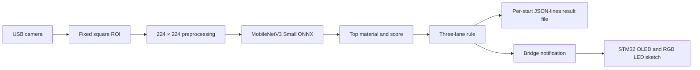

# Waste sorting with machine vision: project status

**As of:** 2026-09-23  
**Branch:** `integration/material-oled`

## Update: wrapper tuning and three-lane routing

Two development branches were merged into `integration/material-oled`: one
added a wrapper-focused training experiment, and the other added disposal-lane
output for the UNO Q logger, OLED, and RGB LED. The merged ONNX export is packaged in
`dist/material-classifier-oled-uno-q.zip`.

The wrapper experiment added 58 annotated TACO crisp-packet and plastic-wrapper
crops to training and reserved 20 crops by source image. The new checkpoint
classifies **18/20** reserved wrappers as `trash`, versus **4/20** before tuning.
On the unchanged 1,118-image mixed test set, accuracy rose from **916 to 931**
correct; food-organic recall rose from **183/194 to 184/194**, and trash recall
from **77/96 to 79/96**. See the [wrapper experiment](../material_classifier/WRAPPER_EXPERIMENT.md)
and [model card](../material_classifier/MODEL_CARD.md) for the split and tradeoffs.
The supplied conveyor wrapper still predicts `cardboard` at **68.7%**, and the
plastic bottle still predicts `paper`; these public-data gains do not establish
conveyor accuracy.

The logger now records `lane` alongside material and confidence. Its MVP rule
maps `food_organic → compost`; `plastic` and `trash → trash`; and cardboard,
glass, metal, and paper `→ recycle`. Low scores keep the predicted material's
lane. The OLED displays the lane above the material; built-in RGB LED #3 shows
green, red, or blue for compost, trash, or recycle.
The external lane LEDs are wired to D3 green, D5 blue, and D6 red; D9 yellow
marks low confidence, and D12 white marks idle or camera error. Built-in LED #3
turns off on a camera or model error. The seven-label app was deployed
to the connected UNO Q: the sketch compiled and uploaded, the app remained the
boot default, and a new result file included `lane`. Board-side ONNX inference
was verified in an earlier check; the new three-lane mapping and Bridge calls
passed on the board. The camera was unavailable during the
ADB check, so live camera classification and physical OLED/LED appearance still
need a test with the camera attached to the board.

## Executive summary

The project has a working **software prototype for one item in view** and a deployed Arduino UNO Q application. A seven-label MobileNetV3 Small classifier runs locally on the Mac and as ONNX on the UNO Q's Linux processor. The board application samples a USB camera, writes camera health, material, confidence, and lane to a new text file each time the application starts, and publishes the result to an OLED and RGB LED sketch on the microcontroller. The repository also retains an earlier YOLOX Nano object-detection demo with live bounding boxes and a simple label-to-lane rule.

The trained classifier performs reasonably on held-out public-dataset photos, especially for `food_organic`. It has **not demonstrated reliable material recognition on the conveyor**: in the three supplied belt photos, it correctly called the cup `paper` but called a wrapper `cardboard` and a plastic bottle `paper`. No labeled food item on the belt has been tested. The current code does not detect an empty belt, localize multiple items for classification, inspect contamination, schedule a diverter, or drive a motor or servo. It therefore does not yet meet the full three-lane, real-time sorter described in the original system-architecture HTML brief.

The latest ADB inspection found **Material Classifier OLED** running as the boot default with the current seven-label model. Its new result file recorded `camera_status: unavailable` and `lane: null` because the camera was not attached to the board during the direct-USB check. The model loaded and ran on the board with a synthetic frame; a live camera-and-item run remains to be observed.

## Scope against the architecture brief

The design brief calls for an offline conveyor sorter with three destinations, at least 10 camera frames per second, multi-item/overlap handling, contamination rules, encoder-timed diversion, and an OLED. Its proposed production model has separate lane, material, and soiling outputs. The implemented classifier has **one seven-class material output** and is sampled once per second by the UNO Q logger.

| Capability | Status in this branch | Evidence / implication |
| --- | --- | --- |
| Mac camera preview | Implemented | [Material preview](../material_classifier/preview.py) shows a fixed crop and top scores; [YOLOX runner](../local_test/__main__.py) separately shows bounding boxes. |
| Seven material labels, including food organics | Trained and exported | [Model definition](../material_classifier/model.py), [checkpoint](../material_classifier/models/food-organic-mobilenetv3-small.pt), [ONNX labels](../uno_q_material_logger/model/labels.json). |
| Offline UNO Q classification | Deployed; live-camera test pending | [App code](../uno_q_material_logger/python/main.py) uses local ONNX Runtime; [packager](../material_classifier/package_uno_q.py) builds `dist/material-classifier-oled-uno-q.zip`. The model loaded and inferred on the board. |
| Camera health, confidence, per-start result file | Implemented in software | [Logger](../uno_q_material_logger/python/material_logger.py) records JSON lines and retries unavailable cameras. A new file is made on each app start, including a boot start. |
| Linux-to-microcontroller OLED and LED output | Compiled and Bridge-tested on board | [Bridge publisher](../uno_q_material_logger/python/display.py) sends lane, material, confidence, and inference time to the [sketch](../sketch/sketch.ino). The OLED shows the lane and material; built-in RGB LED #3 and external lane LEDs show the lane color. |
| Three-lane MVP rule | Deployed and Bridge-tested on board | `food_organic` maps to compost; plastic, trash, and unknown materials to trash; cardboard, glass, metal, and paper to recycle. A low finite score keeps the predicted material's lane. [Logger](../uno_q_material_logger/python/material_logger.py) records the lane. |
| Empty-belt rejection | Not implemented | The image classifier always returns one of seven labels for any valid frame. |
| Per-item detection, overlap separation, tracking | Not implemented for the material app | It uses one fixed square region of interest (ROI), so its output describes the whole crop. |
| Contamination/soiling model and local policy rules | Not implemented | The MVP lane mapping does not inspect soiling or prove that an item is accepted by a local compost or recycling program. |
| Encoder, break beam, diverter servo, belt motor, timing watchdog | Not implemented in the material app | The OLED sketch displays results; it does not perform the planned physical routing. |
| At least 10 fps end-to-end | Not demonstrated | The logger deliberately captures approximately one frame per second; no UNO Q inference-throughput benchmark for the seven-class model is recorded. |

## Two distinct vision paths

### A. Object-detection demonstration

The App Lab example and the Mac runner use a YOLOX Nano model trained on generic COCO object titles. The Mac runner draws bounding boxes; the App Lab example retains a browser video view. [Sorting rules](../python/sorting.py) map `cup → compost`, `bottle → recycle`, and other detected titles `→ trash`, with voting over recent detections. These rules are useful for checking the camera-to-label pipeline. They are **demo rules rather than material or disposal decisions**: a cup can be paper or plastic, and an object title does not reveal food residue. The local ONNX detector and App Lab brick package are separate YOLOX deployments and need not produce identical detections. This path does not use the custom seven-class model.

### B. Material-classification application

The current custom classifier assumes one relevant item in a fixed 90%-of-frame square ROI. It resizes the ROI, center-crops it to 224 × 224 RGB, and applies ImageNet normalization. The Mac uses PyTorch; the UNO Q package uses an exported FP32 ONNX graph and ONNX Runtime on the Linux processor. The camera is requested at 640 × 480, and the board samples about once per second. The top softmax value is logged as `confidence`, but it is **not calibrated** as a probability of a correct sorting decision.

The material logger's result fields are `timestamp_utc`, `uptime_s`, `camera_status`, `material`, `confidence`, `lane`, `inference_ms`, and `error`. Its camera states distinguish unavailable, working, and read-error conditions. On a camera failure, material, confidence, and lane are `null`; the app retries. The OLED path can show `NO CAMERA` or `MODEL ERROR`. The runtime does not need an internet connection once App Lab has installed its dependencies and the model is on the board. See the [UNO Q app guide](../uno_q_material_logger/README.md) for setup and wiring.

## Data and training method

### Original six-class baseline

The first checkpoint used 2,527 images from the six-class TrashNet copy: cardboard, glass, metal, paper, plastic, and trash. It started with torchvision's `MobileNet_V3_Small_Weights.IMAGENET1K_V1` weights. The convolutional backbone was frozen while the classification head was trained. Input size was 224 × 224. A deterministic 70/15/15 split made 1,766 training, 378 validation, and 383 test photos; the best validation checkpoint was from epoch 6 of 8. The source collection largely depicts single objects against a white background, as the [TrashNet creators describe](https://github.com/garythung/trashnet/blob/master/README.md).

### Adding `food_organic`

[Data preparation](../material_classifier/prepare_food_organic.py) kept the original TrashNet split and added `food_waste`, `eggshells`, and `coffee_grounds` from [Alistair King's household-waste dataset](https://www.kaggle.com/datasets/alistairking/recyclable-and-household-waste-classification). The 1,500 candidate organic photos contained repeated or near-duplicate images; perceptual deduplication before splitting left 869 distinct photos. Tea bags were excluded. The first seven-class model retained the existing six output rows and added a new `food_organic` row. It performed well on its own held-out food images but generalized poorly to RealWaste, including many false food-organic predictions.

[Mixed-data preparation](../material_classifier/prepare_food_organic_mixed.py) then added seven mapped classes from [UCI RealWaste](https://archive.ics.uci.edu/dataset/908/realwaste), a 4,752-image, nine-category landfill collection. `Food Organics` mapped to `food_organic` and `Miscellaneous Trash` to `trash`; textile trash and vegetation were omitted. RealWaste images were deduplicated and split into train/validation/test. The final mixed counts were **5,167 / 1,107 / 1,118** images. Its test split contains **603 reserved RealWaste images**, including 62 food-organic photos. The RealWaste test subset is held out from training, but it is **not an entirely unseen source**: other RealWaste images were used for training. Image-level splitting also does not guarantee separation by physical object or photographic session.

The [training code](../material_classifier/train.py) uses random resized crops, horizontal flips, mild color jitter, AdamW, cross-entropy, and optional inverse-frequency balanced sampling. In the final mixed-data phase, the last two backbone blocks were unfrozen, 3,500 balanced samples were drawn per epoch, and the best checkpoint was selected by validation macro recall. Training continued from an intermediate checkpoint after an interrupted run, so its optimizer state was restarted. The full command and checkpoint history are in the [training record](../material_classifier/FOOD_ORGANIC_PROGRESS.md). Original dataset archives and generated splits are ignored local data; checkpoint files and the exported ONNX model are in the repository.

### Wrapper fine-tuning

The current checkpoint continues that mixed-data model with 58 TACO wrapper
crops mapped to `trash`. Another 20 source-image-disjoint crops were reserved
for testing. The [experiment record](../material_classifier/WRAPPER_EXPERIMENT.md)
documents source annotations, preparation, training, and before/after checks.
Downloaded TACO photos are not committed.

## Measured results

| Evaluation | Model and sample | Result | Interpretation |
| --- | --- | --- | --- |
| TrashNet test | Six-class baseline; 383 held-out photos | **85.1%** accuracy (326/383) | Same source and background style as baseline training. |
| King's household-waste sample | Six-class baseline; 1,050 photos from 21 categories with a clear material mapping | **47.1%** top-1 accuracy (495/1,050) | Direct evidence of domain shift; 450 other sampled photos were excluded because the baseline lacked a clear matching class. |
| Mixed seven-class test | Current model; 1,118 held-out photos | **83.3%** accuracy (931/1,118); **83.3%** macro recall | Contains TrashNet, King's data, and RealWaste under a seven-class task. It is not directly comparable to the six-class accuracy. |
| Food organics in mixed test | Current model; 194 true food-organic photos | **94.8%** recall (184/194); **95.8%** precision (184/192 predictions) | Ten misses and eight false food-organic predictions in that split. |
| Reserved RealWaste subset | Current model; 603 photos from seven mapped RealWaste categories | **80.1%** accuracy (483/603); **81.5%** macro recall | Tests different photos from a source represented during training. |
| Food organics in reserved RealWaste subset | Current model; 62 true food-organic photos | **87.1%** recall (54/62); **93.1%** precision (54/58 predictions) | Eight misses and four false food-organic predictions. |
| Reserved TACO wrappers | Current model; 20 source-image-disjoint crops | **18/20** predicted `trash`, versus 4/20 before wrapper tuning | Wrapper photos are more relevant than white-background TrashNet but still differ from the conveyor. |

The first seven-class checkpoint trained without RealWaste achieved only **43.4% food-organic precision** across mapped RealWaste photos, despite high in-source recall. Adding RealWaste and then wrapper images improved the measured held-out results. This is evidence that data source and background matter greatly; it is not proof of conveyor performance. Metrics and confusion data are described in the [model card](../material_classifier/MODEL_CARD.md) and the committed [current metrics JSON](../material_classifier/models/food-organic-mobilenetv3-small.metrics.json).

### Conveyor photographs

Only three labeled non-food belt photos have been evaluated with the current checkpoint. With the board/default 90% centered crop:

| Photo | Expected material | Top prediction | Food-organic score |
| --- | --- | --- | ---: |
| Disposable cup | Paper or cardboard (physical material unconfirmed) | `paper` **94.9%** | **0.6%** |
| Snack wrapper | `trash` | `cardboard` **68.7%** | **1.6%** |
| Plastic bottle | `plastic` | `paper` **69.8%** | **10.8%** |

The high score on the cup and wrong answers on the wrapper and bottle show that softmax confidence cannot be treated as measured sorting accuracy. Earlier manual GrabCut foreground isolation helped the six-class baseline on these three photos, but it required hand-selected object rectangles; a common fixed rectangle did not work. The current model calls the manually isolated, centrally cropped wrapper `trash` at 45.9%, while the raw belt crop still calls it `cardboard`. No reliable automatic item-isolation pipeline has been integrated into the material application. These photos are a diagnostic sample, not a statistically meaningful belt test, and **there is no labeled food-on-belt result**.

## Packaging, deployment, and verification

The [exporter](../material_classifier/export_onnx.py) writes an ONNX graph and `labels.json` containing label order and the source checkpoint's SHA-256. The [packager](../material_classifier/package_uno_q.py) includes the model, Python logger, OLED sketch, bundled display libraries, app metadata, and configuration in `dist/material-classifier-oled-uno-q.zip`. The ONNX file keeps the historical `trashnet-mobilenetv3-small.onnx` filename, but its metadata lists **seven** labels. The PyTorch checkpoint and ONNX export are each about 6 MB. The model has **not been quantized to INT8**, and no power or seven-class inference-speed measurement on the UNO Q is recorded.

Repository tests cover output/preprocessing parity between PyTorch and ONNX, three-lane mapping, camera recovery, per-start result files, display Bridge arguments, packaging, ROI selection, capture labeling, and the YOLOX voting rules. All 18 repository tests pass with the three-lane rule. The updated ONNX model loaded and ran inference inside the UNO Q app's Python environment in an earlier board check. These checks do not establish live camera accuracy on the board.

The three-lane Python and sketch files were deployed to the UNO Q; their SHA-256 hashes matched the repository. The sketch compiled and flashed, the app restarted as the boot default, and a new results file appeared. Board-side Python mapped low-score plastic to trash, paper to recycle, and food organics to compost. Synthetic Bridge calls for all three lanes and the sketch's plastic fallback returned, after which the OLED was restored to `NO CAMERA`. The camera was unavailable on the ADB connection, so live classification and the physical OLED/LED appearance still need direct observation with the camera on the powered hub. App Lab combines Linux Python and an MCU sketch on the UNO Q, consistent with [Arduino's board documentation](https://www.arduino.cc/en/uno-q).

The external LED wiring map from `origin/sk/integration` drives D3/D5/D6 for
compost/recycle/trash, D9 for low confidence, and D12 for idle or camera error.
The external LEDs have not yet been visually checked with the wired hardware.

## Comparison with related work

| Work | What it contributes | Relationship to this project |
| --- | --- | --- |
| [TrashNet](https://github.com/garythung/trashnet/blob/master/README.md) | Original 2,527-image, six-material dataset; authors report around 75% test accuracy on their own 70/13/17 split. | Our six-class baseline uses TrashNet data and reports 85.1% on a **different** split with a pretrained MobileNetV3. Those numbers cannot establish a controlled improvement. TrashNet has no food-organic class and its white-background style differs from our belt. |
| [CompostNet](https://github.com/sarahmfrost/compostnet) | Adds 175 compost and 49 trash photos to TrashNet and trains direct compost/recycle/landfill classifiers; reports better success using MobileNet transfer learning than its custom CNN. | Its disposal-lane labels match the intended product more closely. Our current output is material-like, with `food_organic` as one class; it does not learn local compost rules or contamination. Our mixed dataset uses more organic photos, but the tasks and test sets differ. |
| [RealWaste dataset and study](https://www.mdpi.com/2078-2489/14/12/633) | Photos from an operating landfill across nine categories; its authors report up to **89.19%** accuracy using Inception V3 on their nine-class RealWaste task and show that training on pristine photos transferred poorly. | We incorporated seven of its categories and obtained **80.1%** on a reserved 603-photo subset. Architecture, class mapping, and splits differ, so 89.19% versus 80.1% is context, not a head-to-head benchmark. Our own first seven-class model's false organic positives support their warning about source shift. |
| [TACO](https://github.com/pedropro/TACO) and its [paper](https://arxiv.org/abs/2003.06975) | In-context litter photos with object masks/boxes; the paper describes 1,500 images and 4,784 annotations. | We trained on 58 annotated wrapper crops and reserved 20 by source image. Recognition improved on those held-out wrappers, but the supplied belt wrapper remains wrong; TACO's contexts and taxonomy still differ from the conveyor. |
| [Edge Impulse integration in App Lab](https://blog.arduino.cc/2026/03/04/train-and-deploy-your-own-ai-models-in-arduino-app-lab-now-fully-integrated-with-edge-impulse/) | Official path to collect/train a custom model and select it through an App Lab AI brick. | Our deployed-software design uses a custom PyTorch-to-ONNX pipeline and direct ONNX Runtime instead. That gives local control of training, logging, and the OLED Bridge interface, but requires maintaining our own packaging and runtime. No controlled speed or accuracy comparison has been run. |

The broader research supports transfer learning and collecting photos in the target environment. MobileNetV3 Small was designed as a resource-conscious architecture in the [original MobileNetV3 paper](https://arxiv.org/abs/1905.02244). That is a reasonable starting point for the UNO Q, but model size alone does not establish the brief's timing target. The strongest measured gap here is transfer from public photo datasets to the actual belt, not in-source food-organic recall.

## Risks and next evidence needed

1. **Evaluate the live camera path:** connect the camera through the powered hub and observe material, lane, OLED, LED, and per-start result file with real items. Capture actual inference times rather than assuming 10 fps.
2. **Build a target-domain test set:** photograph distinct physical food items, clean recyclables, wrappers, soiled packaging, and empty-belt frames with the camera in its final position. Keep all shots of each physical item and capture session in one split to reduce leakage. Record ground truth separately from model predictions.
3. **Find items before classifying them:** add a validated object-localization or foreground-segmentation stage and test it on transparent bottles, tall cups, glossy wrappers, and overlapping objects. The current fixed ROI cannot isolate multiple items.
4. **Validate disposal policy and low-score handling:** the current material-to-lane rule is an MVP default, and scores below 60% only trigger a visual warning. Calibrate that warning on belt data, add local soiling and acceptance rules, and explicitly handle no-item and ambiguous frames before an actuator is connected.
5. **Implement and test routing:** only after the vision path meets measured latency and error targets, add tracking, encoder scheduling, Bridge acknowledgments, servo/belt controls, and fault handling from the architecture brief.

Raw training images are not committed. The [King dataset page](https://www.kaggle.com/datasets/alistairking/recyclable-and-household-waste-classification) displays an MIT license badge while its description says educational, research, and non-commercial use; those terms should be resolved before broader distribution of a model trained from it. [RealWaste](https://archive.ics.uci.edu/dataset/908/realwaste) lists CC BY 4.0. This report describes project status and measured experiments, not legal clearance or a verified sorter.
